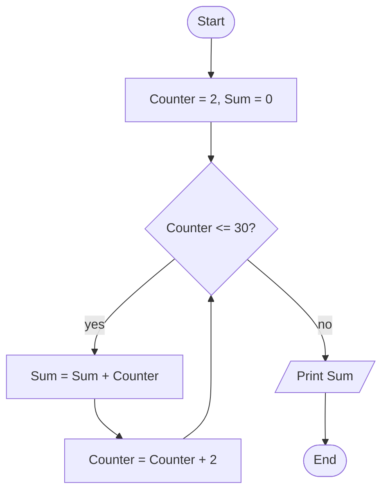

[Basics](#basics) | 
[Why program?](#why) | 
[Life cycle](#pdlc) |
[Problem analysis](#analysis) | 
[Algorithms](#algorithms) | 
[Pseudocode & flowcharts](#represent) | 
[Worked examples](#examples) |
[Languages](#languages) |
[Paradigms](#paradigms) |
[Practice](#practice) | 
[Readings](#readings)

## 1. Basics of program development

Computer program

A self-contained set of explicit and unambiguous instructions that tells the computer to perform specific tasks. It says *what* to do and *how* to do it, determining the operations the machine carries out to solve a problem and produce a specific result. (A device driver is a program.)

Computer programming

Also called programming or coding: the skills used to design and develop programs, including writing, testing, debugging, troubleshooting and maintaining source code.

Software development life cycle

The overall process of software development.

## 2. Reasons to study programming

### Great job prospects

Computers are nearly everywhere and most objects are now connected to them. We live in the digital age and technology keeps growing.

### It makes things easier

Chatting on a smartphone, switching appliances on or off, or unlocking a car with a button all use some kind of program.

### It develops thinking

Coding builds structured, creative and logical thinking, and teaches persistence.

### You learn how to learn

You also become more detail-oriented.

## 3. Program development life cycle

Also called the software development procedure: a conceptual model of the stages of a software project, from the initial planning phase through maintenance of the finished application. It follows a scientific-method and systems approach, as used in science and engineering and in quantitative analysis.

| # | Stage | What happens |
| --- | --- | --- |
| 1 | Planning | Gather information from stakeholders and analyze it to decide what is feasible. |
| 2 | Requirements analysis | Work with stakeholders and users to collect and document the project requirements. |
| 3 | Design | Create the architecture of the software system and its elements (including prototyping). |
| 4 | Implementation | The development team builds the software in a programming language. |
| 5 | Testing and integration | Evaluate software quality to find and fix defects. |
| 6 | Deployment | Release the software to users. |
| 7 | Operations and maintenance | Update and support the software after it reaches the market. |

Reading assignment

Why do we need an SDLC? Write half a page in your own words.

## 4. Problem analysis

### What is a problem?

An undesirable situation that prevents an individual or organization from fully achieving its purpose, goals and objectives. Put another way, it is the gap between the existing and the desired situation. In computing this is a *computational problem*, which may be solved by an algorithm.

**Example (a decision problem):** the answer for every instance is yes or no. "Given a positive integer `n`, determine whether `n` is prime."

### Problem solving

Problem solving is transforming the description of a problem into a solution, using knowledge of the problem domain and the ability to choose suitable strategies, techniques and tools. **Programming is a process of problem solving**, in three steps:

1. **Problem analysis:** understand the problem; identify the program's input and output.
2. **Algorithm design:** design the solution.
3. **Coding:** write a program in a programming language that matches the algorithm's steps.

### The three questions

Problem analysis defines the problem and breaks the system into smaller parts to find its inputs, processes and outputs.

### Input

What data are available?

### Process

What method leads from the data to the results?

### Output

What results does the program have to produce?

**Why analyze first?** To understand the real-world problem and user needs, and to propose and validate abstract solutions before jumping into development.

## 5. Algorithm design

Algorithm

A well-defined, step-by-step, finite set of instructions that specifies a sequence of operations to solve a specific problem or a class of problems. It is independent of any programming language and can be described graphically or in natural language.

The path is: **computational problem → algorithm** (design and analysis) **→ program** (programming).

### Why algorithms?

A computer is an "algorithm-responding" machine, not a "heuristic-responding" one. You cannot tell it to do things directly; it needs a detailed, step-by-step set of instructions for any activity, and together these form an algorithm.

### Characteristics of an algorithm

| Property | Meaning |
| --- | --- |
| Definiteness | Each instruction is clear and unambiguous. |
| Finiteness | It terminates after a finite number of steps. |
| Input | A finite number of inputs (zero or more). |
| Output | At least one well-defined output matching the desired result. |
| Effectiveness | Each instruction is basic enough to be carried out (feasible). |

## 6. Pseudocode and flowcharts

The two most common ways to represent an algorithm.

### Pseudocode

A detailed description of what a program must do, written in natural language (such as English) and mathematical symbols instead of a programming language. It is a semi-programming language for describing algorithm steps.

### Flowchart

A diagram of the algorithm: steps are boxes of various kinds (rectangles, diamonds, ovals) and their order is shown by connecting arrows.

### Flowchart symbols

| Name | Shape | Usage |
| --- | --- | --- |
| Start or Stop (terminal) | Oval | The beginning and end points of the sequence. |
| Process | Rectangle | An instruction or operation to be carried out. |
| Decision | Diamond | A yes/no decision with two or more alternatives. |
| Input or Output | Parallelogram | Data received by the computer, or a result sent from it. |
| Connector | Small circle | A jump from one point to another; avoids crossing lines. |
| Direction of flow | Arrow | Connects symbols and shows the order of instructions. |

## 7. Worked examples

### Example 1: area and perimeter of a rectangle

**Analysis.** Input: length, width. Processing: area = length × width; perimeter = 2 × (length + width). Output: area, perimeter.

```
Start
Read L, W
area = L * W
perimeter = 2 * (L + W)
Print area
Print perimeter
End
```

### Example 2: total salary

**Analysis.** Input: Salary, Overtime. Processing: Total_Sal = Salary + Overtime. Output: Total_Sal.

```
Start
Read Salary
Read Overtime
Total_Sal = Salary + Overtime
Print Total_Sal
End
```

### Example 3: sum of the even integers from 2 to 30

**Analysis.** Input: none. Processing: Sum = 2 + 4 + 6 + … + 30. Output: Sum.

```
Start
Counter = 2, Sum = 0
While Counter <= 30
    Sum = Sum + Counter
    Counter = Counter + 2
End while
Print Sum
End
```



## 8. Programming languages

An artificial language used to control the behavior of a machine, particularly a computer. Like natural languages (such as Amharic), programming languages are defined by syntactic and semantic rules describing their structure and meaning. More specifically, a programming language is:

- a set of written symbols that instruct computer hardware to perform the required operations;
- a linguistic framework for describing computations;
- a set of rules for communicating an algorithm to a computer;
- a tool for developing executable models for a class of problem domains.

### Types and generations

**Low-level:** machine language, assembly language. **High-level:** C, C++, Java.

| Generation | Type | Traits |
| --- | --- | --- |
| 1st | Machine language | 0s and 1s; long, difficult programming. |
| 2nd | Assembly language | Assembles repetitive instructions; shorter code. |
| 3rd | Procedural languages | Include commands; shorter code. |
| 4th | Nonprocedural languages | Application generators; commands specify results. |
| 5th | Intelligent languages | Natural-language processing. |

Progress runs from machine-oriented toward human-oriented (natural) language. There are more than 2,400 programming languages today.

## 9. Programming paradigms

A paradigm is a style, or "way", of programming. It describes how a program should be written and does not refer to one specific language; a language may follow one paradigm or several.

| Paradigm | Description | Model | Examples |
| --- | --- | --- | --- |
| Imperative (procedural) | Statements directly change program state (data fields). | Program = algorithms + data. Good for decomposition. | C, C++, Java, PHP, Python, Ruby |
| Logical (declarative) | Defines the program's logic, not detailed control flow. | Program = facts + rules. Good for searching. | Prolog, SQL, CSS |
| Functional | Computation as evaluation of mathematical functions, avoiding state. | Program = functions of functions. Good for reasoning. | C++, Lisp, Python, JavaScript |
| Object-oriented | Data fields are objects manipulated only through predefined methods. | Program = objects + messages. Good for modelling. | C++, C#, Java, PHP, Python |

## 10. Practice problems

For each one, write the analysis (input, process, output), then pseudocode, then draw the flowchart.

Exercise 1

Identify whether a number is positive or negative.

Hint

This needs a decision symbol. What should happen when the number is zero?

Exercise 2

Read a value `n` and display the sum of the numbers from 1 up to `n`. For n = 5 the output is 15 (1 + 2 + 3 + 4 + 5).

Hint

Use a counter and a running sum, like Example 3, but start at 1 and add 1 each time.

Exercise 3

Accept an initial bank balance, then a sequence of transactions (positive = credit, negative = debit). Input ends with a zero entry. Print the new balance.

Exercise 4

Calculate Zakat: the user enters an amount and the program shows `(2.5 / 100) * amount`. Zakat is not calculated if the amount is less than 1000.

## Summary

In this chapter you learned how to transform computational problems into solutions. You practiced analyzing problems, constructing flowcharts and writing pseudocode.

## Reading resources

- Savitch, W. *Problem Solving with C++*, 10th ed., 2018: Chapters 1–3.
- Zak, D. *An Introduction to Programming with C++*, 8th ed., Cengage, 2016: Chapters 2–3.
- Deitel, P. and Deitel, H. *C++ How to Program*, 10th ed., Global Edition, 2017: Chapter 2.

Fundamentals of Programming I · Addis Ababa Science and Technology University
